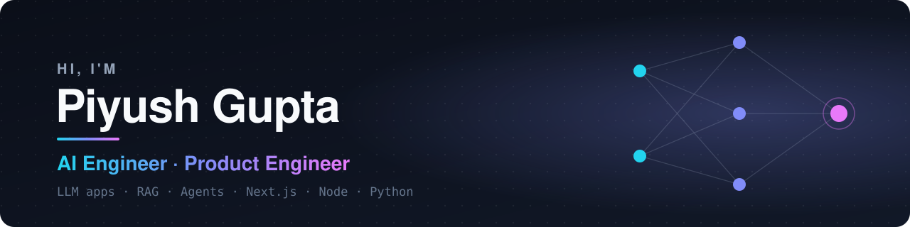
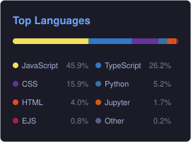

  

  

  
  
  
  
  
  

---

## About me

> ### I take ideas from zero to one, and turn them into products people love.

I'm an **AI Engineer and Product Engineer** from India with **2+ years** of turning raw ideas into live products. I own the entire journey: architecting the system, building the intelligence at its core, crafting an interface that feels effortless, and shipping it into the hands of real users.

For me, launch day isn't the finish line, it's the starting point. I listen, measure and iterate until the product earns its place in people's daily lives.

- 🤖 **Now:** building RAG pipelines, AI agents and LLM-backed web apps
- 🧱 **Learning:** backend architecture and system design at scale
- 🌍 **Open source:** always happy to collaborate. Reach out if you have something interesting
- 💬 **Ask me about:** AI agents, LLM apps and product engineering
- 📫 **Reach me:** [guptapiyush315@gmail.com](mailto:guptapiyush315@gmail.com)

---

## Tech stack

### 🧠 AI & LLM engineering

  
  
  
  
  
  
  
  
  
  
  

  <b>Patterns:</b> RAG · Embeddings & vector search · Tool calling & agents · Prompt engineering · Evals · Streaming UIs

### 📊 ML & data

  
  
  
  
  
  
  
  

### 💻 Languages

  

### 🎨 Frontend

  

### ⚙️ Backend

  

### 📱 Mobile

  

### 🗄️ Databases

  

### ☁️ Cloud & DevOps

  

### 🛠️ Tools

  

---

## GitHub stats

  
  

  

---

  Thanks for stopping by. If something here is useful, a ⭐ on the repo goes a long way.

